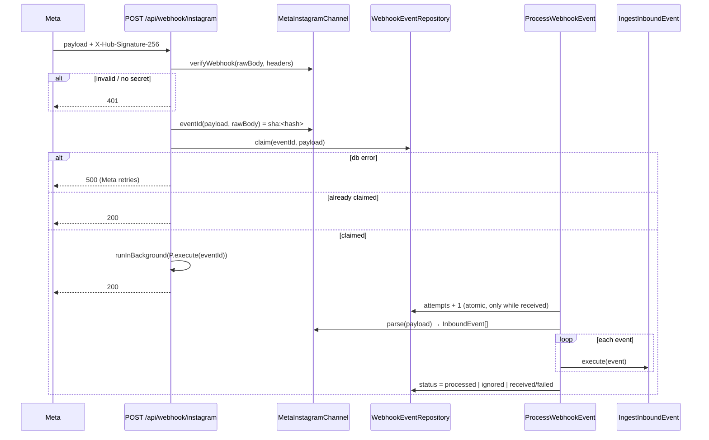

# Design: Messaging Pipeline (Phases 1–3)

Specs: `specs/messaging-pipeline/spec.md`, `specs/api-rest/spec.md`, `specs/activity-status/spec.md`.
Proposal: `proposal.md`. Source analysis: `docs/mejoras-mensajeria-desde-builder-crm.md`.

## 1. Current state (evidence)

| Concern | Today | Evidence |
|---------|-------|----------|
| Webhook | Verify HMAC → parse `entry[0]` only → resolve owner → insert one activity; insert errors still answer 200 | `src/app/api/webhook/instagram/route.ts:38-182` |
| Admin client | Created inline with `SUPABASE_SERVICE_ROLE_KEY`; no shared helper | `route.ts:91-102` |
| Owner lookup | `user_secrets` by `instagram_ig_id`/`instagram_page_id`, `SAFE_ID` guard, single-user fallback | `route.ts:191, 212-265` |
| Parse | Drops echoes and non-text messages; ms vs s timestamps per shape | `InstagramMessagingService.ts:297-366` |
| Send | `sendDM` (graph.facebook.com v25.0) / `sendDMViaInstagramLogin` (graph.instagram.com v25.0); **throw** on error, Meta `code` discarded | `InstagramMessagingService.ts:98-172` |
| Tokens | `InstagramAuthService.getToken(userId)` reads `user_secrets` | `InstagramAuthService.ts:35` |
| Auto DM | `maybeSendAutoDm` called from lead status route; writes nothing | `src/app/api/leads/[id]/status/route.ts:68`, `InstagramAutoTrigger.ts:19-78` |
| Unread badge | `GET /api/activities/unread` counts `INSTAGRAM_MESSAGE` with `read_at IS NULL` (outbound included); Realtime INSERT on `activities` | `SupabaseActivityRepository.ts:209-219`, `useUnreadCount.ts:27,60-75` |
| Inbox | Conversations grouped by `lead_id` or `unlinked:{igsid}` parsed from titles; page marks read row by row | `api/instagram/conversations/route.ts:34-39`, `messages/page.tsx:167-191` |
| Types | `database.types.ts` maintained by hand | `src/infrastructure/database/database.types.ts:1-4` |
| Migration tests | Static regex assertions on SQL text | `supabase/migrations/__tests__/*.spec.ts` |
| Workers | `@opennextjs/cloudflare` 1.20.15; `getCloudflareContext().ctx` is the real `ExecutionContext`; worker exports only `fetch`; `wrangler.toml` has no `[triggers]` | `node_modules/@opennextjs/cloudflare/dist/api/cloudflare-context.d.ts:39-63`, `dist/cli/templates/worker.js` |

## 2. Architecture decisions

### ADR-1 — New `src/modules/messaging` module

Follow the module convention (`src/modules/activities`, `ideas`):

```
src/modules/messaging/
  domain/
    entities/{Conversation,Message,ChannelAccount}.ts
    enums/{Channel,MessageDirection,MessageStatus,MessageOrigin}.ts
    events/InboundEvent.ts
    ports/{MessagingChannel,ConversationRepository,MessageRepository,
           ChannelAccountRepository,WebhookEventRepository}.ts
  application/use-cases/{IngestInboundEvent,DeliverMessage,ProcessWebhookEvent,
                         SweepWebhookEvents,MarkConversationRead}.ts (+ .spec.ts)
  infrastructure/
    channels/MetaInstagramChannel.ts
    repositories/Supabase*Repository.ts
    mappers/*.ts
  index.ts          // messagingModule(supabase) factory
```

Ports are re-exported from `src/core/ports/index.ts` like the activity port. **Why:** the module
pattern is the newest convention in the repo and keeps the domain free of infrastructure.

### ADR-2 — Repositories take an explicit `userId`

The webhook and sweep run with the service-role client and no session, so messaging repositories
MUST NOT rely on `BaseRepository.requireUser()`. Every method receives `userId` and filters by it;
with the user client RLS enforces it a second time. A new `createAdminClient()` in
`src/infrastructure/database/admin.ts` replaces the inline client in the webhook (and is the only
place reading `SUPABASE_SERVICE_ROLE_KEY`). **Why:** one client factory for privileged paths, and the
same repository works under both clients.

### ADR-3 — Background processing via `waitUntil`

`src/lib/runtime/background.ts`:

```ts
export function runInBackground(task: () => Promise<void>): void
```

It calls `getCloudflareContext().ctx.waitUntil(task())`; when no Cloudflare context exists
(Jest, `next dev`) it runs the task and only logs failures. Errors never reach the HTTP response.
**Why:** verified available in the installed OpenNext (§1); the sweep (ADR-5) covers work killed
by the runtime.

### ADR-4 — Claim with one upsert that ignores duplicates

`WebhookEventRepository.claim(eventId, provider, payload)` →
`upsert(..., { onConflict: 'event_id', ignoreDuplicates: true }).select('event_id')`; an empty result
means "already claimed". Event id follows the port contract `eventId(payload, rawBody)`: a provider
delivery id when the payload carries one, else `sha:<sha256(rawBody)>`. Meta Instagram payloads carry
no delivery id, so `MetaInstagramChannel` always returns the hash; a message `mid` is **not** used
(a batch can carry several). **Why:** a single statement, no read-then-write race. The event id is an
optimisation, not the safety net: if Meta re-sends a different body, `mid` dedup (ADR-10) still
prevents duplicate messages, at the cost of re-processing.

### ADR-5 — Sweep endpoint + Cron through a custom worker entry

- `GET /api/webhook/instagram/sweep`, requires `Authorization: Bearer ${CRON_SECRET}` (constant-time
  compare; 401 otherwise, and 401 when `CRON_SECRET` is unset). `/api` is outside the middleware
  matcher (`src/middleware.ts`), so this in-route check is the only guard — the route spec MUST test it.
- `SweepWebhookEvents` takes **at most 5 events per run** through `messaging_claim_retry(p_limit)`, a SQL
  function that atomically selects `received` events older than 2 min with `attempts < 3`
  (`FOR UPDATE SKIP LOCKED`, oldest first), increments `attempts` and returns them. The row lock ends
  when the function commits, so claims also set a lease, `last_attempt_at = now()` (the background run's
  `startAttempt` sets it too), and only events with `coalesce(last_attempt_at, received_at)` older than
  2 min are eligible. Overlapping sweeps or a sweep racing a background run never pick the same event
  (added 2026-11-04 after the overlapping-sweep test exposed the gap). 5 events × ≤5 Supabase calls stays well
  under the Workers per-invocation subrequest limit (50 on the free plan); every 5 min that is 60
  events/h of retry capacity, far above expected failure volume. Each run also deletes `processed`/
  `ignored` events older than 30 days (payload retention: they hold message PII).
- `worker.ts` at the repo root re-exports `.open-next/worker.js` (fetch + durable objects) and adds
  `scheduled(event, env, ctx)`, which calls `handler.fetch(new Request("https://internal/api/webhook/instagram/sweep",
  { headers: { authorization: \`Bearer ${env.CRON_SECRET}\` } }), env, ctx)` — the worker's own fetch,
  so the host is irrelevant and no public URL is needed.
  `wrangler.toml`: `main = "worker.ts"` and `[triggers] crons = ["*/5 * * * *"]`.
- **Why / trade-off:** the installed package has no `scheduled` hook, so this is the only in-platform
  option; it changes the deploy entry point (high-risk item 5), so it ships as the **last, separate
  slice**. Until then the endpoint can be called by an external cron. Rejected: Cloudflare Queues —
  more infrastructure for a single-tenant volume.

### ADR-6 — Processing state machine

```
received --(stored ≥1 message)--> processed
received --(nothing applicable)--> ignored
received --(retryable error, attempts+1 < 3)--> received
received --(retryable error, attempts+1 = 3)--> failed
```

The background run increments `attempts` atomically (`update ... set attempts = attempts + 1 where
event_id = $1 and status = 'received' returning attempts`) before working, so a run killed mid-way
still counts; the sweep increments through `messaging_claim_retry` (ADR-5). No read-modify-write.

### ADR-7 — Channel accounts and owner resolution

`channel_accounts` gets `external_account_id` (= `instagram_ig_id`) plus nullable `page_id`; lookup
matches either column, keeping the `SAFE_ID` guard. `InstagramAuthService.storeToken` upserts the
user's `channel_accounts` row in the same call so new connections stay in sync. Tokens stay in
`user_secrets` (proposal open question, assumed). The **single-user fallback is kept** behind the
same rule as today (exactly one connected user) and is logged when used. **Why:** behaviour parity;
removing the fallback is a multi-tenant decision outside this change.

Conversation `findOrCreate` is race-safe: `insert ... on conflict (account_id, external_id) do nothing`
followed by a select (`upsert` with `ignoreDuplicates`), so two concurrent first messages from the
same participant never raise `23505` or consume a retry attempt. New conversations are inserted with
`unread_count = 0`; the ingest function (ADR-10) applies the `+1`.

A user-facing send for a user without Instagram credentials keeps today's behaviour
(`InstagramAuthService.getToken` throws → current error response); `DeliverMessage` is not reached and
no message row is created.

### ADR-8 — Typed Graph errors instead of message strings

`InstagramMessagingService` send methods throw `GraphApiError extends Error` with
`{ status, code, subcode, type }` and the **same message text** as today, so existing callers keep
working. `MetaInstagramChannel.send` catches it and maps to `SendOutcome`:

| Condition | Hint (UI copy, Spanish) |
|-----------|-------------------------|
| `code 190` or HTTP 401 | Token vencido: reconectá Instagram |
| `code 10`/`200` or HTTP 403 | Faltan permisos de mensajería en la app de Meta |
| HTTP 429 or `code 4`/`613` | Límite de envíos alcanzado, reintentá en unos minutos |
| network / timeout | No se pudo contactar a Instagram |
| other | Meta rechazó el mensaje (`code`) |

Codes 551, 2018278 and 2534022 are **not** mapped until verified against Meta docs (Phase 4 needs
them for the 24h window). A 15 s timeout uses `AbortSignal.timeout`. No automatic retry on send in
this change (avoids double-sending without idempotency keys on Graph).

### ADR-9 — Legacy link column for idempotent migration and rollback writes

`messages.legacy_activity_id uuid UNIQUE NULL`. The history backfill inserts with
`ON CONFLICT (legacy_activity_id) DO NOTHING`; new ingest/delivery stores the id of the legacy
activity written **in the same transaction** as the message (ADR-10), so no crash window exists
between the activity and its link, and a backfill re-run never copies a new-code activity twice.
**Why:** gives the backfill a natural idempotency key and keeps the rollback write lossless.

### ADR-10 — One transaction per state change, via SQL functions

PostgREST cannot express `unread_count = unread_count + 1` nor group several writes in one
transaction. Every multi-row state change is a `SECURITY INVOKER` function with
`set search_path = public` (RLS still applies under the user client; the service role bypasses it as
today):

| Function | Does, atomically | Returns |
|----------|------------------|---------|
| `messaging_ingest_inbound(p_conversation_id, p_external_id, p_type, p_body, p_raw, p_at, p_legacy jsonb)` | insert `in`/`received` message `ON CONFLICT (external_id) WHERE external_id IS NOT NULL DO NOTHING`; only if inserted: insert legacy activity from `p_legacy`, set `legacy_activity_id`, update `last_inbound_at = greatest(...)`, `last_message_*`, `unread_count + 1` | `{ inserted, message_id }` |
| `messaging_record_echo(p_conversation_id, p_external_id, p_body, p_event_at, p_raw, p_legacy jsonb)` | skip when `external_id` exists; else adopt (ADR-12) or insert `out`/`sent`; ensure the legacy activity; update `last_message_*` | `{ outcome: duplicate\|adopted\|inserted, message_id }` |
| `messaging_mark_sent(p_message_id, p_external_id, p_legacy jsonb)` | set `sent` + `external_id` only where `status = 'pending'`; ensure the legacy activity whether this call or an earlier echo made it `sent`; update `last_message_*` | final message row |
| `messaging_claim_retry(p_limit)` | see ADR-5 | events |
| `messaging_set_conversations_read(p_conversation_ids uuid[])` | `unread_count = 0` and `read_at = now()` on their unread inbound legacy activities | — |
| `messaging_sync_legacy_read(p_activity_id, p_read boolean)` | see ADR-11 | — |

"Ensure the legacy activity" = insert it and set `legacy_activity_id` only when it is null, so the
same message never gets two activities. **Why:** a crash can no longer leave a message without its
counter update or its legacy activity (JD-1, JD-12); concurrent events for one conversation do not
lose increments.

### ADR-12 — Echo adoption rule

An echo adopts the most recent `out` message of the same conversation with `external_id IS NULL`,
`status IN ('pending','failed')`, identical body, and `created_at` within **2 minutes before the echo
event's own timestamp** (Meta `timestamp`), not the processing time. A sweep retry minutes later
therefore still adopts the right row instead of duplicating it. Adoption sets `status = 'sent'` and
clears `error_message` and `hint` (covers a send that timed out on our side but was delivered by Meta).

### ADR-11 — Read state and inbox keys

- The inbox keeps its key format (`lead:<leadId>` / `unlinked:<igsid>`) as the conversation `id`
  field, plus `conversationIds`. **A key resolves to a set of conversations:** `lead:<id>` = every
  conversation with that `lead_id`; `unlinked:<igsid>` = the conversations with that `external_id`
  and `lead_id IS NULL`. This matches today, where a lead key covers all of the lead's Instagram
  activities.
- `GET /api/messages?key=` merges the messages of the set, ordered by `created_at`. The inbox list
  shows one entry per key with `unreadCount` = sum and `lastMessage` = most recent of the set.
- New `PATCH /api/messages/read` with `{ key }` runs `MarkConversationRead` →
  `messaging_set_conversations_read(set)`. The page replaces its row-by-row loop
  (`page.tsx:167-191`) with this call.
- `DELETE /api/messages` with a key, in this order: (1) delete the legacy `INSTAGRAM_MESSAGE`
  activities matched as today (lead key: by `lead_id`; unlinked key: by title), which also covers
  activities never copied; (2) delete the conversations of the set (messages cascade). `legacy_activity_id`
  has no FK, so step 1 must not depend on the cascade.
- `PATCH /api/messages` (link) sets `lead_id` on the conversations of the `unlinked:` set and on
  their legacy activities.
- `GET /api/activities/unread` keeps path and `{ count }`, returning `sum(unread_count)`.
- The existing activity-level read operations stay consistent: `MarkActivityRead`/`MarkActivityUnread`
  on an inbound `INSTAGRAM_MESSAGE` activity also call `messaging_sync_legacy_read`, which decrements
  (floor 0) or increments the `unread_count` of the conversation linked through
  `messages.legacy_activity_id`, only when `read_at` actually changes. Activities without a linked
  message (not copied) only change `read_at`, as today.
- `useUnreadCount` subscribes to `INSERT` and `UPDATE` on `public.conversations` (filter
  `user_id=eq.<id>`) and refetches; this also fixes today's increment on outbound inserts.

## 3. Flows

### 3.1 Inbound webhook



### 3.2 Ingest of one event

```mermaid
sequenceDiagram
  participant I as IngestInboundEvent
  participant A as ChannelAccountRepository
  participant Cv as ConversationRepository
  participant M as MessageRepository (SQL functions)
  I->>A: findByExternalId(accountId)  (fallback: single connected user)
  alt not found
    I-->>I: ignored
  end
  I->>Cv: findOrCreate(account, participantId) — insert on conflict do nothing + select; link lead by instagram_scoped_id
  alt kind = message
    I->>M: messaging_ingest_inbound(..., legacy "Instagram DM from {igsid}")
    Note over M: one transaction: message + legacy activity + unread/last_* — or nothing if mid exists
  else kind = echo
    I->>M: messaging_record_echo(..., event timestamp, legacy "Instagram DM to {igsid}")
    Note over M: duplicate → no-op; adopt pending/failed (ADR-12) or insert; ensure legacy activity
  end
```

### 3.3 Delivery

```mermaid
sequenceDiagram
  participant Caller as send route / InstagramAutoTrigger
  participant D as DeliverMessage
  participant M as MessageRepository
  participant C as MetaInstagramChannel
  Caller->>D: execute(conversation, text, origin)
  D->>M: insert out/pending
  D->>C: send(ctx, message) → SendOutcome
  alt ok
    D->>M: messaging_mark_sent(id, messageId, legacy "Instagram DM to {igsid}")
    Note over M: no-op on status if an echo already adopted it; legacy activity ensured either way
  else failed
    D->>M: status = failed, error_message, hint (only while pending — an adopted row stays sent)
  end
  D-->>Caller: final Message
```

`SendContext` carries the token data from `InstagramAuthService.getToken(userId)`; the adapter keeps
today's branch on `authType` (`facebook` → `sendDM`, `instagram_business_login` →
`sendDMViaInstagramLogin`). The lead send route keeps its handle resolution and `needsManualId`
responses unchanged and only replaces the send + activity write with `DeliverMessage`.
`InstagramAutoTrigger.maybeSendAutoDm` keeps its signature and `boolean` return; internally it
uses `DeliverMessage` with `origin='auto'`.

## 4. Data model

Migration **A** `20261103000000_messaging_tables.sql` — the spec table plus: `channel_accounts.page_id`,
`messages.legacy_activity_id UNIQUE`, `messages.hint`, `updated_at` columns, FK indexes
(`conversations(user_id, last_message_at desc)`, `conversations(lead_id)`, `messages(conversation_id)`),
`webhook_events` with RLS enabled and no policy, the functions of ADR-10, and
`ALTER PUBLICATION supabase_realtime ADD TABLE conversations, messages`.

RLS policies check ownership of every referenced row, not only `user_id` (repo style, with the
`(select auth.uid())` form so it is evaluated once per statement):

| Table | `USING` | `WITH CHECK` adds |
|-------|---------|-------------------|
| `channel_accounts` | `user_id = (select auth.uid())` | — |
| `conversations` | same | `account_id` in the user's `channel_accounts`; `lead_id IS NULL` or in the user's `leads` |
| `messages` | same | `conversation_id` in the user's `conversations` |

Migration **B** `20261103000001_backfill_instagram_messages.sql` defines
`messaging_backfill_instagram_history()` (`SECURITY DEFINER`, `search_path = public`, `EXECUTE`
revoked from `public`, `anon`, `authenticated`) and calls it once. Because a numbered migration runs
only once, rollout step 4 calls the **function** again from the SQL editor (`select
messaging_backfill_instagram_history();`). The function, in one transaction:
1. `channel_accounts` from `user_secrets` where `instagram_ig_id IS NOT NULL` (`ON CONFLICT DO NOTHING`).
2. For users with legacy activities but no `channel_accounts` row: a placeholder account with
   `status = 'disconnected'` and `external_account_id = 'legacy:' || user_id`, so their history is
   still copied (reconnecting later creates the real account; merging is out of scope).
3. Conversations per (user, igsid) with `substring(title from '^Instagram DM (?:from|to) (\d+)$')`
   (`ON CONFLICT DO NOTHING`); `lead_id` = latest non-null lead among that participant's activities.
4. Messages per activity, `ON CONFLICT (legacy_activity_id) DO NOTHING`.
5. **Additive** counter update for the conversations that received rows in this call only:
   `unread_count + (inserted inbound with legacy read_at IS NULL)`, `last_inbound_at`/`last_message_at`
   = `greatest(current, inserted max)`, preview from the newest. Never an overwrite, so a re-run
   concurrent with live webhook increments cannot lose them.
6. Returns and `RAISE NOTICE`s counts: copied, already copied, skipped for unparseable title, and
   copied into placeholder accounts.

`database.types.ts` is updated by hand for the four tables and the function.

## 5. Rollout and rollback

1. Apply A (additive).
2. Apply B (defines the backfill function and copies history).
3. Deploy code (new webhook, readers and senders; legacy activities still written).
4. Run `select messaging_backfill_instagram_history();` — idempotent and additive; copies activities
   the old code wrote between steps 2 and 3 (new-code activities are already linked, ADR-9).
5. Configure Meta `message_echoes` subscription; set `CRON_SECRET`.
6. Deploy the Cron slice (ADR-5).

Runbook in `docs/messaging-pipeline-rollout.md` (mirrors `docs/activities-status-rollout.md`).

**Rollback:** revert code → old routes read legacy activities, which are complete thanks to the
rollout write; read state matches because `MarkConversationRead` also sets `read_at`. The Cron slice
reverts independently (restore `main = ".open-next/worker.js"`). Full revert: a migration dropping the
four tables and the function.

## 6. Testing strategy (strict TDD)

| Layer | Tests |
|-------|-------|
| Migrations | Static specs in `supabase/migrations/__tests__/` asserting tables, CHECKs, partial unique index, RLS with ownership `WITH CHECK` + no policy on `webhook_events`, publication, every ADR-10 function (`ON CONFLICT ... WHERE`, `FOR UPDATE SKIP LOCKED`, `security invoker`, `search_path`), backfill function (`security definer`, revoked `EXECUTE`, placeholder accounts, additive counters) |
| SQL behaviour | The ADR-10 functions hold the atomicity rules, which static specs cannot prove: run them against a local Supabase (`supabase start`) in a dedicated `pnpm test:db` script, covering duplicate mid, echo adopt/insert/duplicate, mark-sent after adoption, claim-retry concurrency and backfill re-run. If a local stack is unavailable in CI, this suite runs manually and its result is recorded in the verify report |
| Use cases | In-memory fakes of the ports: duplicate mid, conversation create race, echo adoption measured from the event timestamp (inside/outside 2 min, different body, failed row), new participant, lead link, attachment placeholder, delivery ok/failed/adopted-first, sweep bounds and state machine |
| Adapter | `global.fetch` mock: both payload shapes, multiple entries/messages, echo, timestamps, `GraphApiError` mapping table, timeout |
| Routes | Existing mocking style (`jest.mock` of services, `with-auth`): webhook 401/500/200 + background scheduled, duplicate claim, sweep 401/200, send routes keep 400/404/502 bodies, conversations/messages shapes, `PATCH /api/messages/read`, unread count |
| Regression | Existing specs for send, conversation, tenant isolation and `InstagramAutoTrigger` stay green, adapted only where the store changed |

## 7. Work units (input for tasks)

| # | Unit | Risk |
|---|------|------|
| 1 | Migration A + types + migration spec | item 1 (persisted format) |
| 2 | Domain, ports, use cases with fakes | none |
| 3 | `GraphApiError`, `MetaInstagramChannel`, Supabase repositories, `createAdminClient`, `runInBackground` | item 3 (service error type shared by callers) |
| 4 | Webhook rewrite + sweep endpoint | item 2 (signature guard), item 4 (concurrent ingest) |
| 5 | Senders, auto trigger, readers, `/messages/read`, unread hook, page wiring, OpenAPI | item 3 (endpoint contracts) |
| 6 | Migration B (backfill function) + spec + rollout runbook | item 1 (data copy) |
| 7 | `worker.ts` + `wrangler.toml` Cron | item 5 (deploy entry point) |

## 8. Open points

- `CRON_SECRET` naming and storage in Cloudflare secrets — assumed.
- Whether Meta re-sends the identical body on retry (assumption behind the body-hash event id); if
  not, dedup by `mid` still prevents duplicate messages, at the cost of re-processing.
- Placeholder `legacy:` accounts are not merged with a real account when the user reconnects; their
  conversations stay visible but separate. Merge is a follow-up if it happens in practice.

## 9. Judgment Day resolutions (2026-11-03)

| ID | Resolution |
|----|-----------|
| JD-1 | ADR-10: `messaging_ingest_inbound` writes message, legacy activity and counters in one transaction |
| JD-2 | §4/§5: backfill is a re-callable function; rollout step 4 calls it |
| JD-3 | ADR-7: conversation insert `on conflict do nothing` + select |
| JD-4 | ADR-4 and §3.1 aligned with `eventId(payload, rawBody)`; `mid` dedup is the safety net |
| JD-5 | ADR-5: 5 events per sweep, atomic `messaging_claim_retry` with `SKIP LOCKED` |
| JD-6 | ADR-11: activity read/unread sync the conversation counter via `messaging_sync_legacy_read` |
| JD-7 | ADR-10/12: echo adopts `pending` or `failed`, clears error; legacy activity ensured on every path to `sent` |
| JD-8 | ADR-12: window measured from the echo event timestamp |
| JD-9 | ADR-11: a key resolves to a set of conversations; DELETE order defined |
| JD-10 | §4: `WITH CHECK` verifies ownership of `account_id`, `lead_id`, `conversation_id` |
| JD-11 | §4: placeholder `disconnected` accounts; counts reported per category |
| JD-12 | ADR-9/10: legacy activity and link in the same transaction; 30-day purge of handled events; send without credentials keeps today's error |
| JD-13 | ADR-5: scheduled handler calls the worker's own fetch; ADR-7/11: conversations created with `unread_count = 0`, hook listens to INSERT and UPDATE |
